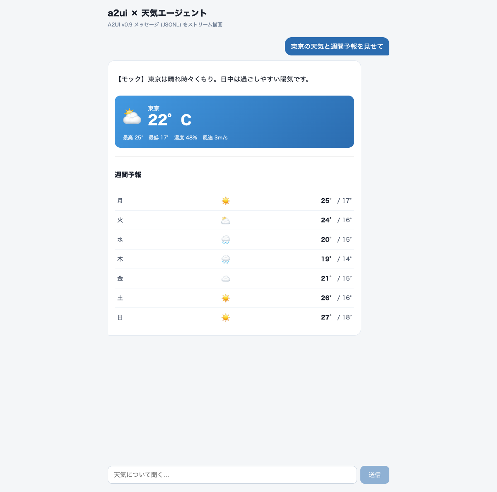
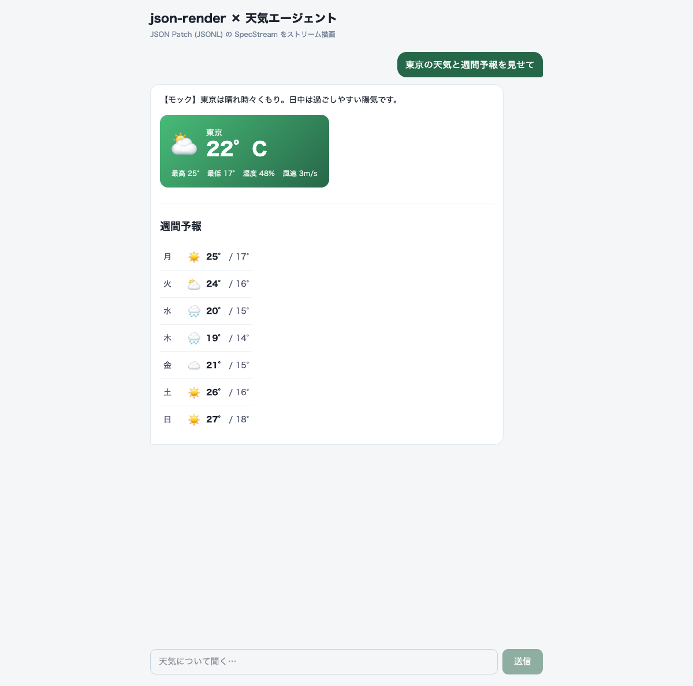

# Generative UI 比較: a2ui vs json-render

同じお題(**AIエージェントが天気のUIを構築してチャットに返す**)を
[a2ui](https://github.com/a2ui-project/a2ui) と [json-render](https://github.com/vercel-labs/json-render) の両方で実装し、
実装の流れ・挙動の違いを比較するワークスペース。

| | a2ui-app | json-render-app |
|---|---|---|
|  | |  |

## 構成

```
apps/
  a2ui-app/          @a2ui/react + @a2ui/web_core (v0.9)     port 5210 (青系)
  json-render-app/   @json-render/core + react + shadcn      port 5211 (緑系)
```

各アプリは Vite 1プロセス構成:

- フロント: React チャットUI
- サーバー: Vite dev middleware (`/api/chat`) が `@anthropic-ai/sdk` で **claude-opus-4-8** を streaming 呼び出し
- カスタムコンポーネント(両アプリ共通のお題): **WeatherWidget**(現在の天気カード) / **WeatherIcon**(天気アイコン) / **WeeklyForecastList**(週間予報リスト)
- それ以外は既存カタログを利用(a2ui: basicCatalog / json-render: @json-render/shadcn)

## 起動

```bash
pnpm install
cp .env.example .env   # ANTHROPIC_API_KEY を設定。無ければモック応答で動く

pnpm dev:a2ui          # http://localhost:5210
pnpm dev:json-render   # http://localhost:5211
```

「東京の天気と週間予報を見せて」などと聞くと、LLM が UI スペックをストリームで返し、段階的に描画される。

---

## 実装の流れの比較

### a2ui (apps/a2ui-app)

1. **カスタムコンポーネント定義** — API(Zod スキーマ)と実装(React FC)を分離して定義し、`Catalog` に登録
   ```ts
   // src/weather/catalog.tsx
   const WeatherWidgetApi = { name: "WeatherWidget", schema: z.object({ city: CommonSchemas.DynamicString, ... }) };
   const WeatherWidget = createComponentImplementation(WeatherWidgetApi, ({ props }) => <div>...</div>);
   export const weatherCatalog = new Catalog(CATALOG_ID, [Text, Row, Column, Card, ..., WeatherWidget], BASIC_FUNCTIONS);
   ```
   標準 basicCatalog のコンポーネント(Text, Card, Column, ... 18種)は個別 export されているので、カスタムと混ぜた独自カタログを作れる。
2. **システムプロンプト** — **手書き** (`server/systemPrompt.ts`)。A2UI v0.9 の3メッセージ型・コンポーネント一覧・出力例を自分で記述する必要がある(プロンプト自動生成ヘルパーは Python SDK `a2ui-agent-sdk` にしかない)。
3. **サーバー** — LLM に「A2UI メッセージの JSONL」を出力させ、テキストをそのままストリーム。
4. **クライアント** — 行単位でパースし、1行 = 1 A2UI メッセージを `processor.processMessages([msg])` に投入。`<A2uiSurface surface={...} />` が signals ベースで自動更新。

### json-render (apps/json-render-app)

1. **カタログ定義**(LLM に見せる語彙) — `defineCatalog` に Zod props を渡す。shadcn の既存定義はそのまま再利用
   ```ts
   // src/render/catalog.ts
   export const catalog = defineCatalog(schema, {
     components: {
       Card: shadcnComponentDefinitions.Card, ...,
       WeatherWidget: { props: z.object({...}), description: "..." },
     },
   });
   ```
2. **レジストリ定義**(React 実装) — `defineRegistry(catalog, { components })`。カタログと型が連動し、実装漏れ・props 齟齬はコンパイルエラーになる。
3. **システムプロンプト** — **`catalog.prompt({ mode: "standalone", customRules })` で自動生成**。カタログ定義から出力形式・コンポーネント一覧・実例まで組み立ててくれる。
4. **サーバー** — LLM に「JSON Patch (RFC 6902) の JSONL」を出力させ、そのままストリーム。
5. **クライアント** — `createSpecStreamCompiler()` にチャンクを `push` するだけで行バッファリング・パッチ適用・新参照生成をやってくれる。結果の `spec` を `<Renderer spec registry />` へ。

---

## 挙動・思想の違い

| 観点 | a2ui | json-render |
|---|---|---|
| ワイヤ形式 | 専用メッセージ型 (`createSurface` / `updateComponents` / `updateDataModel`) | 汎用 JSON Patch (RFC 6902) の JSONL |
| UI 構造 | フラットリスト + ID 参照 (`children: [id]`) | フラット `elements` マップ + `root` (ほぼ同じ思想) |
| ストリーミング粒度 | メッセージ単位。LLM は 1 つの `updateComponents` に全コンポーネントを入れがちで、体感は一括表示寄り | パッチ単位。要素を1個ずつ `add` するので段階描画が自然に起きる |
| データと構造 | **分離が第一級**。データモデルに `updateDataModel`、UI からは `{"path": "/xxx"}` で参照。UI を作り直さず値だけ更新できる | props 直書きが基本。必要なら `$state` / `$template` / `$cond` / `$bindState` で状態参照 |
| プロンプト生成 | TS には無し(手書き ~60行)。Python SDK には `generate_system_prompt()` あり | `catalog.prompt()` 一発 + customRules 数行 |
| カスタム実装の書き味 | `createComponentImplementation`。binder が動的値(path参照)を解決してから props に渡してくれる | 素の React FC (`{ props, children, emit }`)。もっとも普通の React |
| 既存カタログ | basicCatalog 18種。**実装・スタイル同梱**で追加セットアップ不要 (`injectStyles()`) | shadcn 36種。**Tailwind v4 + テーマCSS変数のセットアップが必要** |
| 双方向性 | client capabilities / dataModel をサーバーに返すプロトコルが仕様に含まれる (A2A/AG-UI 前提) | `emit("press")` → action handlers / `useBoundProp`。アプリ内で完結 |
| バリデーション | メッセージ全体を Zod で検証。カタログ不一致はエラー | `catalog.validate(spec)` / strict JSON Schema 出力 (`catalog.jsonSchema()`) も可 |
| 出自と重心 | Google 発。**プロトコル仕様が本体**(バージョニング、catalog ネゴシエーション、エージェント間相互運用) | Vercel Labs 発。**DX が本体**(プロンプト生成、ストリームコンパイラ、AI SDK 連携が同梱) |

### やってみて分かったこと

- **書く量はほぼ同じ、書く場所が違う。** カスタムコンポーネント3種 + チャットシェルの実装量は両者ほぼ同等。差が出たのはサーバー側で、a2ui はプロトコル仕様をプロンプトに自分で書き下ろす必要があり(このリポジトリでは ~60 行)、json-render は `catalog.prompt()` + ルール4行で済んだ。
- **ストリーミング対応のコスト差。** json-render は `createSpecStreamCompiler` が行バッファも差分適用もやってくれる。a2ui の TS クライアントには相当物が無く、行パースを自前で書いた(~20行)。本来の a2ui は A2A/AG-UI の SSE トランスポートに乗る想定で、素の fetch ストリームは想定外寄り。
- **a2ui の「データモデル分離」は更新系で効く。** `updateDataModel` だけ送れば UI 構造を再送せず値が変わる(signals で自動反映)。json-render で同じことをするなら `replace` パッチで props を書き換えるか `$state` 参照 + `setState` を使う。
- **既存カタログの導入コスト。** a2ui basicCatalog は `injectStyles()` 一発。json-render shadcn は Tailwind v4 + `@source` 指定 + テーマ CSS 変数(examples/chat から流用)が必要だった。
- **LLM の出しやすさ。** どちらもフラット構造 + ID 参照で、ネスト JSON より LLM が増分生成しやすい設計。json-render のパッチ形式のほうが1行が短く、途中で切れても被害が1パッチで済む。

## メモ

- `ANTHROPIC_API_KEY` 未設定時は `server/mock.ts` が実LLMと同じワイヤ形式のモックを流す(描画パスの検証用)。
- モデルは `claude-opus-4-8` + adaptive thinking + streaming。
- 参考にしたローカルリポジトリ: `~/pjt_personal/a2ui`(v0.9 spec, samples/client/react/shell), `~/pjt_personal/json-render`(examples/chat)。
