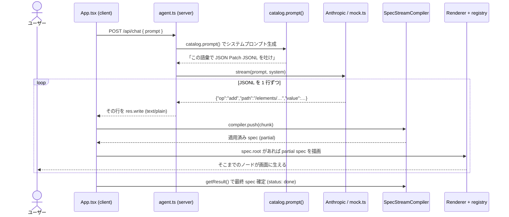

# json-render の「UI がじわじわ組み上がる」流れ

> 「json-render は少しずつ UI が組成されている感じがする。JSON Patch で徐々に add してるから？」
> → **その通り。** サーバーが RFC 6902 の JSON Patch を **1行=1パッチ** の JSONL でストリームし、クライアントが届いた順に spec ツリーへ `add` していく。ノードが 1 つ増えるたびに React が再レンダーするので、UI が節ごとに生えてくる。

---

## 1. 登場人物（このリポジトリの実物）

| 役割 | ファイル | やること |
|------|----------|----------|
| catalog | `apps/json-render-app/src/render/catalog.ts` | LLM に見せる語彙（`WeatherWidget` 等）を定義。`catalog.prompt()` でシステムプロンプトを自動生成 |
| server | `apps/json-render-app/server/agent.ts` | `POST /api/chat`。LLM(or モック) から **JSON Patch の JSONL** を `text/plain` でストリーム |
| mock | `apps/json-render-app/server/mock.ts` | APIキー無し環境で流す固定パッチ列（描画パス検証用） |
| client | `apps/json-render-app/src/App.tsx` | ストリームを `createSpecStreamCompiler` に食わせ、spec が更新されるたび再レンダー |
| registry | `apps/json-render-app/src/render/registry.tsx` | catalog の各部品の React 実装 |

---

## 2. 全体シーケンス



肝は **ループの中で毎回描画している**こと。全パッチが揃うのを待たない。

---

## 3. コードで追う incremental add

### サーバー: 1行=1パッチを流すだけ (`agent.ts`)

```ts
// APIキー無し → モックを 200ms 間隔で 1 行ずつ
for (const line of mockLines()) {
  res.write(line + "\n");
  await sleep(200);
}
// 本番 → LLM のテキストをそのまま垂れ流す (LLM が JSONL を書きながら流れる)
stream.on("text", (text) => res.write(text));
```

- モックは `sleep(200)` で意図的に「じわじわ」を演出。
- 本番は LLM がトークンを吐くそばから `res.write` するので、1 行(=1パッチ)が完成するたびクライアントに届く。

### クライアント: 届いた分だけ spec に積んで再描画 (`App.tsx`)

```ts
const compiler = createSpecStreamCompiler<Spec>({ elements: {} }); // 空ツリーから開始
for (;;) {
  const { done, value } = await reader.read();
  if (done) break;
  const chunk = decoder.decode(value, { stream: true });
  const { result, newPatches } = compiler.push(chunk);   // 完成した行だけ patch 化して適用
  if (newPatches.length > 0) patchMessage(assistantId, { spec: result }); // ← 差分が出たら再レンダー
}
```

- `compiler.push` はチャンク境界を吸収し、**完成した JSONL 行だけ**をパッチとして spec に適用する。
- 新しいパッチが出た時だけ `setState` → React 再レンダー。
- 描画側は partial spec を許容する：`spec.root` と `elements[root]` が揃った瞬間から描き始め、以降ノードが増えるたび描き足す（`App.tsx:95`）。

---

## 4. 実際に「生える」順番（mock.ts のリプレイ）

`mock.ts` のパッチを上から適用すると、画面はこの順で育つ：

| # | パッチ | 画面の変化 |
|---|--------|-----------|
| 1 | `add /root = "main"` | まだ空（root の指す実体が無い） |
| 2 | `add /elements/main = Stack(children:[])` | **空の縦スタックが出現** |
| 3 | `add /elements/summary = Text(…)` | 実体だけ用意（まだ親に繋がってない） |
| 4 | `add /elements/main/children/- = "summary"` | **要約テキストが Stack に生える** |
| 5 | `add /elements/widget = WeatherWidget(…)` | 実体用意 |
| 6 | `add /elements/main/children/- = "widget"` | **天気カードが生える** |
| 7 | `add /elements/sep = Separator` → children に push | **区切り線が生える** |
| 8 | `add /elements/title2 = Heading("週間予報")` → push | **見出しが生える** |
| 9 | `add /elements/forecast = WeeklyForecastList(…)` → push | **週間予報リストが生える** |

ポイントは **「実体の追加」と「親 children への参照追加」が別パッチ**なこと（`/elements/main/children/-` の `-` は配列末尾に append）。だから構造が 1 ノードずつ、しかも「箱 → 中身」の順で積み上がる。これが「じわじわ組成される」体験の正体。

---

## 5. なぜ a2ui は同じようには“生えない”のか（このリポジトリでの差）

同じ「天気」を a2ui でやると、ストリームの **1 単位の粒度**が違う（`apps/a2ui-app`）：

- json-render の 1 行 = **1 ノード分のパッチ**（超細粒度）。
- a2ui の 1 行 = **1 メッセージ**。しかも `updateComponents` は**コンポーネントツリー全体を 1 メッセージに flat で同梱**する（`a2ui-app/server/mock.ts`）。

クライアント（`a2ui-app/src/App.tsx`）は **完成した JSON 行 1 本を 1 メッセージとして処理**するので、巨大な `updateComponents` 行が丸ごと届くまで構造が描かれない → **どちらかというと「一気に出る」**。データも `updateDataModel` で先に一括投入される。

> つまり「じわじわ感」は思想の差というより、**ストリームの最小単位が "ノード" か "メッセージ(ツリー全体)" か**の粒度差から来ている。
> a2ui も `updateComponents` を分割送信すれば細かく生やせるし、逆に json-render も全パッチを 1 チャンクで送れば一気に出る。このリポジトリの実装ではたまたま json-render=ノード単位 / a2ui=ツリー一括、になっている。

---

## 6. `$state` binding 版との差分（正直なところ）

json-render の「本格的な」書き方は **`{$state:"/weather/condition"}` の binding + `/state/weather` へのデータ投入**という「state 内包」型になる。
このリポジトリの実装は**そこまでやっていない**：

- getWeather tool も `$state` binding も使わず、天気の値を**コンポーネントの props に直書き**している（`WeatherWidget props.temperature=22` など）。
- システムプロンプトのルールも「天気データはもっともらしい値を創作してよい(実APIは呼ばない)」（`agent.ts:14`）。

どちらも正しい json-render の使い方で、このリポジトリは**デモとして最小構成（props 直書き）**を選んだ、という位置づけ。`$state` 版は「データを state に集約して binding で参照する」一段リッチな形、と読み替えればよい。

---

## 7. 一言まとめ

- **UI がじわじわ組成されるのは、RFC 6902 の `add` パッチを 1 行ずつストリームし、届くたびに spec ツリーへ append → 再レンダーしているから。** daitasu の直感どおり。
- 特に「実体追加」と「children への参照追加」が別パッチなので、箱→中身の順で節ごとに生える。
- a2ui との“生え方”の違いは思想ではなく**ストリーム単位の粒度**（ノード vs メッセージ）。
